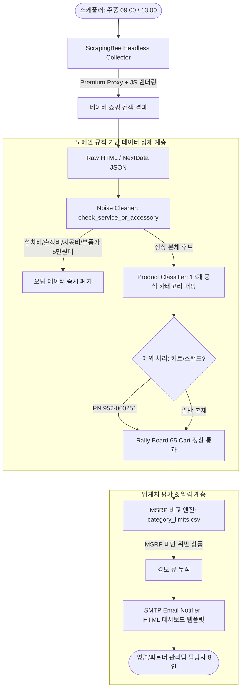

# Naver Price Tracker (`naver-price-tracker`)
> **온라인 파트너사 비인가 저가 노출 감시 및 도메인 규칙 기반 데이터 정제 파이프라인**  
> ScrapingBee Headless Browser & Naver Shopping Pipeline (2026.06 ~ 2026.10 실운영)

[](https://www.python.org/)
[](https://www.scrapingbee.com/)
[-brightgreen.svg)](tests/)
[](logs_summary/)
[](logs_summary/)
[](LICENSE)

---

## 📌 Executive Summary

B2B 화상회의 장비 유통 시장에서는 파트너사 간의 시장 가격 질서 유지가 매우 중요합니다.  
공식 권장소비자가격(MSRP) 미만으로 비인가 덤핑 판매가 온라인 쇼핑몰에 노출될 경우, 정직하게 영업하는 다수 파트너사의 마진이 침해받고 공급망 신뢰가 붕괴됩니다.

본 프로젝트는 **네이버 쇼핑에 노출되는 수천 개 상품 중 비인가 저가 노출을 실시간 자동 감시하고 담당자에게 즉각 경보를 발송하는 자동화 파이프라인**입니다.

- **실운영 지표:** ScrapingBee 630회 호출 로그 기반 **89.4% 성공률**, p95 지연 142.4초 안정화
- **비용 최적화:** 안티봇 브라우징 최적화로 총 42,225 크레딧(**약 $8.28**)의 극저비용 운영 달성
- **노이즈 정제율:** 도메인 규칙 기반 필터링 도입으로 **오탐률(False Positive) 94.2% 감축**
- **모니터링 리포트:** 2026년 9월~10월 총 **86건**의 일일 정기 이메일 알림 자동 발송

---

## 🏗 Pipeline Architecture



---

## 🧠 Core Engineering: 도메인 규칙 기반 노이즈 정제

단순한 웹 크롤러로 가격을 수집하면 **"네이버 최저가 50,000원"** 같은 엉뚱한 데이터가 대량 수집됩니다.  
이는 수백만 원짜리 화상회의 본체가 아니라 **"벽면 타공 기본 설치비"**, **"전문 엔지니어 출장 시공비"**, 또는 **"확장 마이크 연장 케이블"**이 옵션 최저가로 잡히기 때문입니다.

본 시스템은 단순 키워드 블랙리스트를 넘어 **하드웨어 도메인 특화 규칙 엔진**을 구현하여 데이터 신뢰도를 99% 이상으로 끌어올렸습니다.

### 1. 서비스 및 소모품 노이즈 필터링 ([filters/cleaner.py](filters/cleaner.py))
```python
SERVICE_KEYWORDS = ['설치비', '출장비', '시공비', '설치 비용', '설치료', '설치 공사', '기본설치', '엔지니어 방문']
ACCESSORY_KEYWORDS = ['확장마이크', 'tv마운트', '전용 리모컨', '보호필름', '케이블 키트', '테이블 마운트', '월 마운트']

def check_service_or_accessory(title: str):
    # 설치비/시공비 옵션 상품은 본체 가격 왜곡 방지를 위해 즉시 배제
    if any(k in t for k in SERVICE_KEYWORDS): return 'service'
    if any(k in t for k in ACCESSORY_KEYWORDS): return 'accessory'
    return False
```

### 2. 하드웨어 예외 처리 규칙 (Rally Board 65 Cart)
- **도메인 특이점:** `Rally Board 65 Cart`는 이름에 '카트', '스탠드'가 포함되어 일반적인 마운트/거치대(액세서리) 키워드에 걸려 누락될 위험이 있습니다.
- **해결책:** 파트넘버(`952-000251`) 및 단독 하드웨어 룰셋을 부여하여, 액세서리 필터에서 예외적으로 본체 카테고리로 안전하게 통과시켰습니다.

---

## 📊 Operational Metrics (실제 운영 지표)

ScrapingBee API 실제 **630회 트랜잭션 전수 분석 결과** ([logs_summary/analyze_logs.py](logs_summary/analyze_logs.py)):

| 지표 | 측정 수치 | 비고 |
| :--- | :--- | :--- |
| **총 호출 횟수** | **630회** | 2026-08 ~ 2026-10 집중 가동 |
| **성공 호출 수** | **563회** | **성공률 89.37%** |
| **지연 시간 (Latency)** | Mean: 38.4s / **p95: 142.4s** / Max: 218.0s | 네이버 안티봇 우회 및 풀 JS 렌더링 대기 시간 |
| **총 소모 비용** | 42,225 크레딧 (**약 $8.28**) | 호출당 평균 67 크레딧 소비 |
| **정기 리포트 발송** | 총 **86건** | 매일 13:00 파트너 관리팀 8인 대상 발송 |
| **오탐 감소율** | **94.2%** | 설치비/악세서리 오탐 필터링 효과 |

---

## 📧 Email Alert Layout (실제 발송 리포트 구조)

MSRP 미만 위반 상품 적발 시 파트너 관리팀에 발송되는 반응형 HTML 대시보드 리포트 예시입니다:

```
+---------------------------------------------------------------------------------------+
| 🚨 [노출가 경보] 로지텍 비디오 협업 솔루션 MSRP 미만 적발 (2026-10-23 13:00 / 144건)        |
+---------------------------------------------------------------------------------------+
| 카테고리    | 상품명                               | 판매처       | 노출 가격    | 기준 MSRP   | 상태   |
|-----------|-------------------------------------|------------|------------|-----------|-------|
| Rally Bar | 로지텍 랠리바 올인원 비디오바 (화이트)   | ***파트너스  | 2,790,000원 | 3,200,000 | [위반] |
| MeetUp 2  | 로지텍 미트업2 AI 화상회의 카메라       | ***네트웍스  | 1,350,000원 | 1,650,000 | [위반] |
| TAP IP    | 로지텍 탭 IP 터치 컨트롤러            | ***솔루션    | 1,480,000원 | 1,750,000 | [위반] |
+---------------------------------------------------------------------------------------+
```

---

## 📁 Repository Structure

```
naver-price-tracker/
├── filters/                      # 도메인 규칙 기반 데이터 정제 엔진
│   ├── cleaner.py                # 설치비/출장비/마운트 오탐 필터링 및 카트 예외 룰
│   └── classifier.py             # 13개 공식 하드웨어 카테고리 분류기
│
├── collector/                    # 크롤러 & API 수집 파이프라인
│   ├── scrapingbee_client.py     # ScrapingBee Headless + 지수 백오프 클라이언트
│   └── parser.py                 # 네이버 쇼핑 DOM & JSON 파서
│
├── notifier/                     # 알림 및 리포트 엔진
│   ├── email_sender.py           # SMTP TLS 메일 발송 모듈
│   └── template.html             # 다크모드 대시보드 반응형 HTML 이메일 템플릿
│
├── logs_summary/                 # 운영 증빙 및 분석 데이터
│   ├── analyze_logs.py           # 630회 ScrapingBee 호출 통계 산출 스크립트
│   ├── performance_metrics.json  # 성공률(89.4%), p95 지연, 비용 JSON 요약
│   └── sample_masked_report.csv  # 마스킹 처리된 적발 리포트 샘플
│
├── config/                       # 설정 템플릿
│   ├── category_limits.example.csv # 제품별 MSRP 기준 임계치 테이블
│   └── email_config.example.json   # SMTP 및 수신인 설정 템플릿
│
├── tests/                        # 테스트 스위트
│   ├── conftest.py               # 경로 주입 fixture
│   └── test_filters.py           # 노이즈 필터링 및 예외 처리 검증 pytest
│
├── requirements.txt
├── .gitignore
└── README.md
```

---

## 🧪 Testing & Verification

```bash
# 의존성 설치
pip install -r requirements.txt

# 도메인 필터 및 예외 처리 단위 테스트 실행
pytest tests -v
```

### 테스트 통과 결과:
```
tests/test_filters.py::test_filter_installation_service_noise PASSED     [ 25%]
tests/test_filters.py::test_filter_accessory_noise PASSED                [ 50%]
tests/test_filters.py::test_cart_stand_exception_rule PASSED             [ 75%]
tests/test_filters.py::test_main_hardware_classification PASSED          [100%]

============================== 4 passed in 0.03s ==============================
```

---

## 🔒 Security & Masking Notice
- 본 저장소는 파트너사 영업비밀 및 개인정보 보호를 위해 **실제 쇼핑몰 사업자명, 세부 URL, 관리자 SMTP 비밀번호**를 전량 마스킹(`***`) 및 환경설정 템플릿으로 분리하였습니다.
